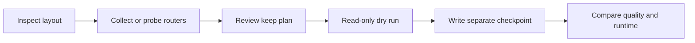

# MoE Expert Pruning & Router Analysis for Safetensors

[](https://github.com/dibyapp/MoE-Watcher-Modifier/actions/workflows/cpu-check.yml)
[](LICENSE)

**MoE-Watcher-Modifier** is an experimental Python toolkit for **Mixture-of-Experts expert pruning**:
inspect a safetensors checkpoint, estimate expert usage, build a keep/drop plan, and rewrite supported
checkpoint layouts with fewer experts. It targets researchers exploring LLM model compression and
contributors who want a reproducible checkpoint workflow.

The CPU inspection, router-only probing, and rewriting pipeline does not require a GPU. Full-model
collection needs enough memory for the model. Pruning can degrade quality; fewer stored experts do
not automatically mean faster inference, lower peak memory, or compatibility with every runtime.

## Why use it?

- Inspect router and expert tensor names before attempting a rewrite.
- Compare per-layer or global keep plans using activation counts or probability sums.
- Run a **read-only dry run** before writing a separate output checkpoint.
- Compact retained expert IDs, slice router rows, update configuration, and write a manifest.
- Try the pipeline on tiny synthetic fixtures before downloading any large model.

[Install](#installation) · [Workflow](#checkpoint-pruning-workflow) · [Compatibility](docs/COMPATIBILITY.md) ·
[FAQ](#faq) · [Validation](docs/VALIDATION.md) · [Contribute](CONTRIBUTING.md)

## Installation

Use Python **3.10+** and a virtual environment. Start with Python 3.11 if you want the CI reference setup.
Install a PyTorch build suitable for your platform using the [official selector](https://pytorch.org/get-started/locally/).

### Linux / Ubuntu / macOS

```bash
git clone https://github.com/dibyapp/MoE-Watcher-Modifier.git
cd MoE-Watcher-Modifier
python3 -m venv .venv
source .venv/bin/activate
# Linux/Ubuntu, CPU-only:
python -m pip install torch --index-url https://download.pytorch.org/whl/cpu
# On macOS, use this instead of the CPU-index command:
# python -m pip install torch
python -m pip install -r requirements.txt
python -m unittest discover -s tests -v
```

### Windows PowerShell

Activation is optional: use the environment's interpreter directly.

```powershell
git clone https://github.com/dibyapp/MoE-Watcher-Modifier.git
cd MoE-Watcher-Modifier
py -3 -m venv .venv
.\.venv\Scripts\python.exe -m pip install torch --index-url https://download.pytorch.org/whl/cpu
.\.venv\Scripts\python.exe -m pip install -r requirements.txt
.\.venv\Scripts\python.exe -m unittest discover -s tests -v
```

The remaining examples use `python` from the virtual environment. On Windows without activation,
substitute `.\.venv\Scripts\python.exe`. For full-model collection or checkpoint tokenization in
daemon mode, install `python -m pip install -r requirements-full.txt`.

## Choose the right measurement

| Mode | What it does | What the result means |
| --- | --- | --- |
| `inspect` | Reads checkpoint structure and tensor names | Layout inspection; not a compatibility certification |
| `router-only` | Passes random hidden vectors through router weights | Synthetic router behavior, **not real prompt routing** |
| `full-model` | Hooks matching gate modules during prompt forward passes | Counts derived from gate outputs; verify model-specific routing semantics |
| `daemon` | Proxies requests; passes token embeddings through each router | **Embedding-based heuristic**, not backend routing telemetry |
| `report` | Re-ranks a saved report | Reuses the original measurement and its limitations |

`full-model` uses a generic softmax/top-k calculation. Models with grouped routing, sigmoid scores,
bias correction, fused gates, or custom gate outputs need additional validation. Calibration prompts
should represent your workload, with a separate evaluation set for quality checks.

## Checkpoint pruning workflow

Provide your own locally available, licensed safetensors checkpoint. `./checkpoints/model` below is
a placeholder; the project does not ship or automatically download model weights.
**Choose `--keep-experts` and `--new-topk` within your checkpoint's actual counts.** The values below
illustrate a checkpoint with at least four experts; they are not a recommended compression ratio.



```bash
python moe_monitor.py inspect --model-dir ./checkpoints/model
python moe_monitor.py router-only --model-dir ./checkpoints/model --output ./outputs/report.json --keep-experts 4 --new-topk 2 --samples 1024 --strategy per-layer
python moe_prune.py dry-run --model-dir ./checkpoints/model --plan ./outputs/report-plan.json
python moe_prune.py prune-checkpoint --model-dir ./checkpoints/model --plan ./outputs/report-plan.json --output-dir ./outputs/pruned-model --copy-support-files
```

The output directory must be empty and separate from the source, including its parents and children.
The dry run validates the plan and tensor transformation without creating files. A failed real rewrite
may leave partial output: keep the source, inspect the error, and choose a new empty output directory.

For actual prompt forward passes, create a local JSONL file with one `{"prompt":"Your calibration text"}`
object per line, then run:

```bash
python moe_monitor.py full-model --model-dir ./checkpoints/model --prompts ./prompts.jsonl --output ./outputs/full-report.json --keep-experts 4 --new-topk 2
```

Custom model code is disabled by default. Only add `--trust-remote-code` after reviewing and trusting
the checkpoint's code. There is no built-in fine-tuning, quality benchmark, GGUF conversion, or runtime certification.

To re-rank the existing report with another keep count:

```bash
python moe_monitor.py report --input ./outputs/report.json --keep-experts 2 --new-topk 1
```

`uniform-plan` keeps arbitrary expert IDs for pipeline experiments; it is not an importance-based plan.
Use `python moe_monitor.py --help` and `python moe_prune.py --help` for the full CLI.

## Experimental request proxy

```bash
python moe_monitor.py daemon --model-dir ./checkpoints/model --backend http://localhost:11434 --listen-host 127.0.0.1 --listen-port 8080 --keep-experts 4 --new-topk 2 --output ./outputs/live-report.json --report-every 50
```

This proxy loads router weights **and the embedding table**; loading may read whole shards. Memory
requirements depend on the checkpoint. Without a usable tokenizer it falls back to character-derived
IDs, making the estimate still less representative. It does not execute custom tokenizer code.

The current proxy buffers complete backend responses, including streaming responses, and handles
requests through a single-threaded HTTP server. It has no built-in authentication, TLS, queue limit,
or latency guarantee. Keep it on loopback for local experiments. Request bodies and authorization
headers are forwarded to the configured backend; use only a backend you trust.

Reports are emitted every N analyzed prompts and on Ctrl+C. SIGUSR1/SIGHUP report triggers are Unix-only.
This mode is useful for heuristic experiments, **not evidence that those experts were used in inference**.

## Supported layouts

Named schemas exist for `mixtral`, `qwen3_next`, `qwen_moe`, `deepseek`, `phi3_moe`, and `olmoe`.
Actual support depends on exact tensor names and config keys, not just the model family name.
The rewriter requires individually named experts such as `experts.0.w1.weight` and 2D router weights.
Packed/fused expert tensors, quantized auxiliary tensors, and model-specific routing changes are not
generically handled. See [compatibility and evaluation](docs/COMPATIBILITY.md) before pruning.

## FAQ

**Can I prune a MoE model on CPU?** Inspection, random router probing, and supported-layout rewriting
run on CPU. Allow enough RAM for the source shard and transformed tensors, and enough disk for a new checkpoint.

**Does it work with Mixtral, Qwen, DeepSeek, and OLMoE?** Schemas are provided, but each checkpoint
must match the documented layout. CI uses a tiny synthetic Mixtral-style fixture; it does not certify
the full models or every version of a family.

**Does pruning reduce VRAM without hurting quality?** There is no universal guarantee. Measure output
quality, task metrics, peak memory, and latency against the original model on the same workload.

**Are router-only and daemon reports real expert usage?** They are estimates. Full-model hooks are
closer to actual activations, but their scoring and hook coverage still need model-specific checks.

**Why does a rewrite reject my checkpoint?** Check config counts, router shape, expert ID coverage,
and naming. A schema name cannot adapt an unsupported fused or packed representation.

**Can I share a report?** Reports and manifests may contain local paths. Remove personal paths,
private prompts, identifiers, and proprietary information first. Keep private outputs in ignored directories.

## Tests, development, and license

Run `python -m unittest discover -s tests -v`. CI exercises CPU fixtures on Linux, Windows, and macOS.
Read [validation boundaries](docs/VALIDATION.md), [contribution guidance](CONTRIBUTING.md), and
[historical development notes](DEVLOG.md). Historical logs and plots are not current quality or performance promises.

Created by [dibyapp](https://github.com/dibyapp). Original source is [MIT licensed](LICENSE);
model weights and dependencies retain their own terms. If this helps your experiments, a reproducible
bug report, compatibility result, or star helps others discover the project.
